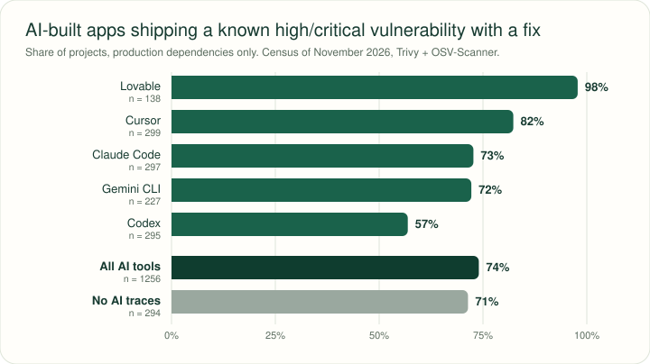
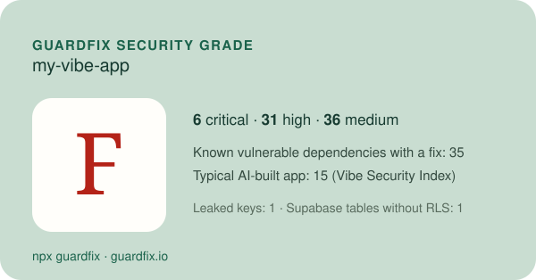
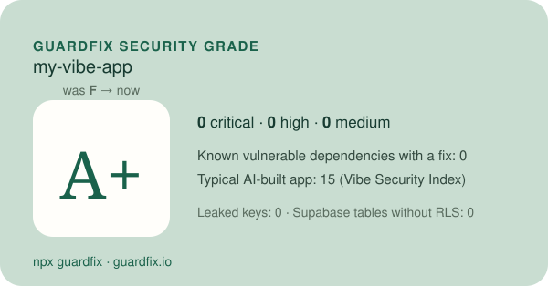

<p align="center"></p>

<h1 align="center">GuardFix</h1>

<p align="center">
  <b>One command gives your vibe-coded app a security grade.<br>A second one gives your AI a prompt to fix it.</b>
</p>

<p align="center">
  
  
  
  
</p>

<p align="center">
  
</p>

```sh
npx guardfix
```

No sign-up, no config. It reads your lockfile and your code on your machine in a few seconds.

## Why it exists

| **74%** | **98%** | **15** | **82%** |
|:---:|:---:|:---:|:---:|
| of 1,256 public AI-built apps ship a known high or critical vulnerability that already has a fix | of Lovable apps do | such vulnerabilities in the median AI-built app | of fixes GuardFix applied on 45 unseen apps passed install, rescan and build |

The fix is usually one version bump. The vulnerable app still runs fine, though, so nobody bumps it. Data and method: [Vibe Security Index](https://github.com/guardfix/vibe-security-index).

<picture>
  <source media="(prefers-color-scheme: dark)" srcset="assets/chart-dark.svg">
  
</picture>

## From F to A+ with one prompt

<table>
  <tr>
    <td width="50%"></td>
    <td width="50%"></td>
  </tr>
  <tr>
    <td><code>npx guardfix --card</code> before</td>
    <td>after the prompt below, same command</td>
  </tr>
</table>

`npx guardfix --prompt` prints instructions your assistant can act on. Paste them into Claude Code, Cursor or Codex:

```text
Fix these security problems found by GuardFix in this project. Keep the change minimal.

1. Upgrade these dependencies to at least the version shown (...):
   - next: 14.1.0 -> 15.5.28  (worst: critical, 36 advisories: GHSA-…, …)
   - axios: 1.6.0 -> 1.20.0  (worst: high, 31 advisories: …)
   - lodash: 4.17.20 -> 4.18.1  (worst: high, 4 advisories: …)
   ...
   Regenerate the lockfile with the project's own package manager (package-lock.json), do not edit it by hand.
2. Also fix:
   - Supabase service_role key in client code: anyone can read and change all data (src/lib/supabase.ts:5)
   - Supabase table "profiles" has no row level security: ... (supabase/migrations/0001_init.sql)
   For a leaked key: move it to an environment variable on the server side, and tell me to rotate the key ...

Then: install from scratch, run the build and the tests, and run `npx guardfix` again.
```

Each version shown has been checked again in OSV. Advisories often get fixed one at a time: a plain "first fixed version" can still carry the next advisory. lodash 4.18.0 is one example. GuardFix keeps moving up until the version is clean.

Run `--card` again after fixing and the card shows **was F → now A+**. It also prints a README badge:

[](https://guardfix.io)

## In Claude Code

```text
/plugin marketplace add guardfix/guardfix
/plugin install guardfix
/guardfix fix
```

It checks the project and fixes what it can. It reinstalls, builds and checks again, then shows the grade before and after. It never prints key values. Before touching a database it shows you the RLS migration.

### It keeps watching while you code

The plugin also adds two hooks:

- **When a session starts**, it looks your locked versions up again and tells you what is new since last time: an advisory published for a package you use, or a vulnerable version an install brought in. *"GuardFix: new since 2026-11-18 — axios 1.7.4 (high) → 1.8.2. Run /guardfix fix"*. Nothing new, nothing said.
- **Before the AI writes a file**, it stops the edit if the edit adds a key to the code, a dependency pinned to a version with a known high or critical vulnerability, or a Supabase table without row level security. Claude gets the reason and what to do instead, and rewrites the edit: the key goes to an environment variable, the version goes up, the migration gets its policies. Only what the edit adds is checked, and a key in a git-ignored `.env` is fine.

Both send only package names and versions to OSV.dev, like the CLI. If OSV is unreachable they stay quiet and never block. `GUARDFIX_WATCH=0` turns off the session check, `GUARDFIX_GUARD=0` the guard. The watch state is kept in `~/.guardfix`, outside your project.

## What it checks

| | How | Why it matters for vibe-coded apps |
|---|---|---|
| **Vulnerable dependencies** | Reads the lockfile (npm, pnpm, yarn, bun, poetry, uv, requirements.txt) and looks up the exact versions in [OSV.dev](https://osv.dev) | 3 in 4 AI-built apps ship one |
| **Leaked keys** | OpenAI, Anthropic, Stripe live, AWS, GitHub and Google keys, private keys, and the **Supabase `service_role` key** in client code. A key in a local `.env` that git ignores is fine and is not counted | A key in the frontend bundle is public. A `service_role` key opens your whole database |
| **Supabase without RLS** | Tables of the `public` schema in `supabase/migrations` without `enable row level security`. Migrations are read in order, so RLS turned on later counts and removed tables are skipped. The owner column for the policy is named when it can be found | With RLS off, anyone holding your public anon key can read the table |

**Grade:** the worst problem decides it. Any critical issue gives F, and any high issue gives D. Medium and low issues give C, B or A. A clean project gets A+. Dev-only dependencies are listed separately and don't lower the grade. Without the dependency lookup (`--offline`, or OSV.dev unreachable) the grade is marked incomplete and no card or badge is made.

## Want it done for you, and proven?

[GuardFix](https://guardfix.io) applies each fix in a sandbox before you see it: clean install, rescan with two scanners, build and tests. Then it opens a pull request. It also keeps watching the project and tells you when a new advisory hits a package you use.

| | `npx guardfix` (free) | [guardfix.io](https://guardfix.io) |
|---|:---:|:---:|
| Grade, vulnerable deps, leaked keys, Supabase RLS | ✓ | ✓ |
| Prompt for your AI assistant | ✓ | ✓ |
| Fix applied and verified (install, rescan, build, tests) | | ✓ |
| Pull request with the verified fix | | ✓ |
| Alerts on new advisories | | ✓ |
| Live site check: headers, exposed files, trackers | | ✓ |

## Privacy

Only **package names and versions** leave your machine. They go to OSV.dev, which looks up the advisories. Your code and keys stay local. `--offline` skips the dependency lookup completely. Keys found in the code are always masked in the output.

## Options

| | |
|---|---|
| `npx guardfix [path]` | check a folder (default: current) |
| `--json` | machine-readable result |
| `--prompt` | fix instructions for your AI assistant |
| `--card` | write `guardfix-card.svg` and print a badge |
| `--offline` | no network: keys and Supabase only |

The exit code is 1 for grade D or F, which is handy in CI. It is 0 otherwise and 2 on errors. Requires Node 18+, no dependencies.

The pictures on this page come from a real run on a demo app with the old versions an assistant typically scaffolds: [`scripts/render-assets.js`](scripts/render-assets.js). The "after" card is the same app with the versions the check suggested, the key moved to an env variable and RLS on.

## Contact

Questions, false positives, a security report: [tech@guardfix.io](mailto:tech@guardfix.io) or an [issue](https://github.com/guardfix/guardfix/issues).

## License

Apache-2.0
